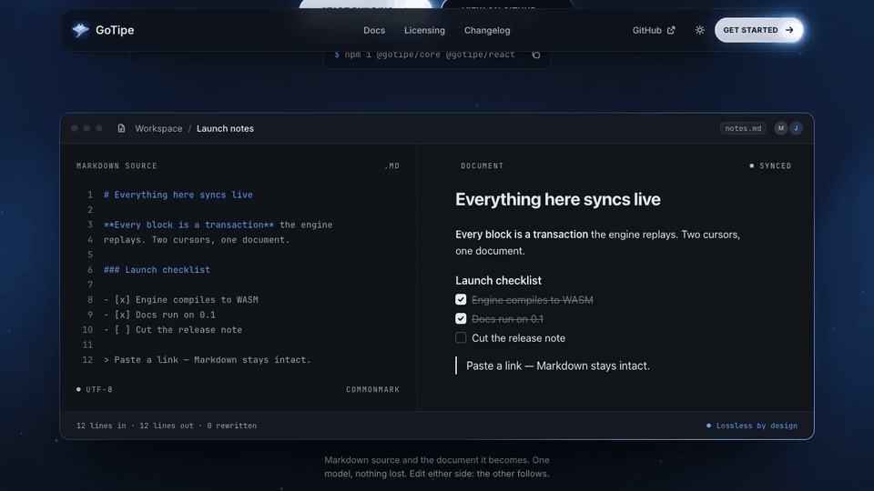

<p align="center">
  <a href="https://gotipe.com"></a>
</p>

<h1 align="center">GoTipe</h1>

<p align="center">
  A block editor for apps that store Markdown.<br>
  Edit the document. Keep the Markdown diff focused.
</p>

<p align="center">
  <a href="https://gotipe.com">Website</a> ·
  <a href="https://gotipe.com/docs/">Docs</a> ·
  <a href="https://crates.io/search?q=gotipe">Crates</a> ·
  <a href="https://gotipe.com/docs/resources/changelog/">Changelog</a>
</p>

Edit a paragraph without rewriting the rest of your Markdown file. GoTipe's Markdown snapshot
preserves the original bytes of untouched content; changed blocks may use the serializer's preferred
syntax. `PageEditor` manages the snapshot for you. Headless integrations keep it alongside the
document and use it when saving. [How Markdown preservation works](https://gotipe.com/docs/conversion/markdown/).

Choose the integration that fits your app:

- **MIT headless packages** — the editor core and adapters for React, Vue, Svelte and Solid;
  you build and style the interface.
- **Commercial ready-made UI** — React `PageEditor` and `BlockEditor`, with the `@gotipe/theme`
  styles. [Package licenses](https://gotipe.com/docs/resources/licensing/).

[](https://gotipe.com/)

One checkbox, one changed Markdown line. This 16-second recording shows the live editor and
source side by side. [Watch the MP4](https://github.com/veniameen/gotipe/raw/refs/heads/main/.github/assets/markdown-edit-demo.mp4)
or [try it on the website](https://gotipe.com/).

[**Try the React starter in StackBlitz**](https://stackblitz.com/github/veniameen/gotipe/tree/main/examples/vite-react?file=src%2Feditor.tsx)
· [Run the Markdown byte-preservation example](https://gotipe.com/docs/guides/edit-markdown-without-reformatting/)

If GoTipe would be useful in your project, star the repository to keep it handy.

## Get started

In an existing React project that uses shadcn/ui, add the ready-made editor:

```sh
npx shadcn@latest add @gotipe/block-editor
```

The registry item installs the editor and its required packages. The ready-made UI and theme use
commercial licenses. For headless packages or manual installation, follow the
[installation guide](https://gotipe.com/docs/getting-started/installation/) and
[quick start](https://gotipe.com/docs/getting-started/quick-start/).

<details>
<summary>Start a new Next.js or Vite app</summary>

For Next.js:

```sh
npx create-next-app@latest my-editor --example https://github.com/veniameen/gotipe/tree/main/examples/nextjs
```

For Vite:

```sh
npx degit veniameen/gotipe/examples/vite-react my-editor
```

The [starters](examples) use the ready-made React editor and the published packages.

</details>

## PageEditor

```tsx
import { useState } from 'react';
import { PageEditor } from '@gotipe/block-editor';
import '@gotipe/theme/base.css';
import '@gotipe/theme/theme.css';

export function Document() {
  const [markdown, setMarkdown] = useState('# Document\n\nStart writing.\n');
  return <PageEditor markdown={markdown} onChange={setMarkdown} locale="en" />;
}
```

PageEditor renders with a shared view: `view` is `notion` (the default), `docs`, `modern` or
`minimal`. To store files, provide `host.saveAsset` and `host.resolveAsset`. Without a host, small
files are embedded in the document as data URLs; callbacks and limits are described in the
[media contract](docs/development/assets.md).
Use `getJSON()` for the full rich-document structure; Markdown preserves the syntax and semantics of
the supported Markdown constructs, not arbitrary JSON.

## AI coding agents

GoTipe ships a skill that teaches coding agents to install, configure and debug it:

```sh
npx skills add veniameen/gotipe
```

In Claude Code: `/plugin marketplace add veniameen/gotipe`, then `/plugin install gotipe@gotipe`.
Tools that discover skills by domain can read the [GoTipe skill index](https://gotipe.com/.well-known/agent-skills/index.json).
Agents can also read [llms.txt](https://gotipe.com/llms.txt), which lists every docs page, and the
Markdown copy of any page at the same address with `.md` instead of the trailing slash.

## Engine and collaboration

GoTipe owns its TypeScript and Rust/WASM engines, Markdown codec, transactions, history and CRDT.
It does not use Tiptap or ProseMirror. The same document and transaction contracts serve the
headless adapters and ready-made UI.

`engine: 'js'` works without WASM and suits a strict CSP. `engine: 'wasm'` enables Rust and
collaboration; `'auto'` tries WASM and falls back to JS when the module is unavailable. Schema and
document errors are never masked by switching engines.

GoTipe Cloud is the source of the backend you deploy yourself: API, WebSocket, PostgreSQL,
background exports and AI adapters. There is no hosted GoTipe Cloud. Your application owns saving,
permissions and its page structure.

Each version's changes are in the [changelog](https://gotipe.com/docs/resources/changelog/); the
required checks are in the [test matrix](docs/development/testing.md).

## Local setup

You need Node.js, the pnpm version from `packageManager`, Rust with `wasm32-unknown-unknown`,
wasm-pack and Binaryen (`wasm-opt`). Building the full workspace includes a separate PDF/DOCX WASM:

```sh
pnpm install --frozen-lockfile
pnpm build:wasm
pnpm build:export-wasm
pnpm build
pnpm --filter @gotipe/playground exec vite --host 127.0.0.1 --port 5173
```

Local address: `http://127.0.0.1:5173/`. PageEditor opens by default; the other examples are
available from the menu. The PDF/DOCX exporter loads only when you run the corresponding export and
is not part of the main editor WASM.

## Stack

Rust + WASM (Core) · TypeScript + pnpm + Turborepo (Packages) · Go + Chi (Cloud API) · PostgreSQL · Valkey · Playwright (E2E)

## Documentation

- [Development rules and SOLID](AGENTS.md), [code map](docs/development/code-map.md)
- [Dependencies](docs/development/dependencies.md), [checks](docs/development/testing.md)
- [Browser synchronization](docs/development/browser-collaboration.md)
- [Cloud API and operational contracts](docs/development/cloud-contract.md)
- [WASM budget](docs/development/wasm-budget.md)

Documents `00`–`20` describe the original design and requirements. An idea appearing there does not
confirm that it is implemented; check status against the release plan, the public API and the
current tests.

## License

The headless packages are licensed under MIT. The ready-made UI and theme packages keep their own
commercial license, stated in their `package.json` and LICENSE files. License files and third-party
compiler and font notices are included in the package archives.
